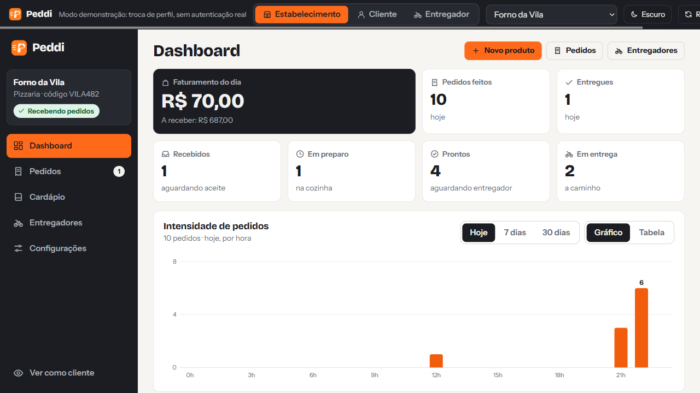
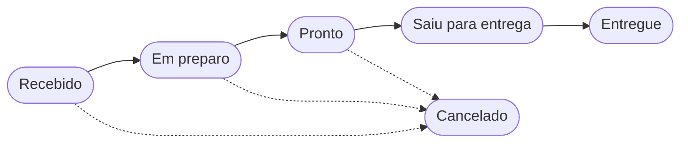
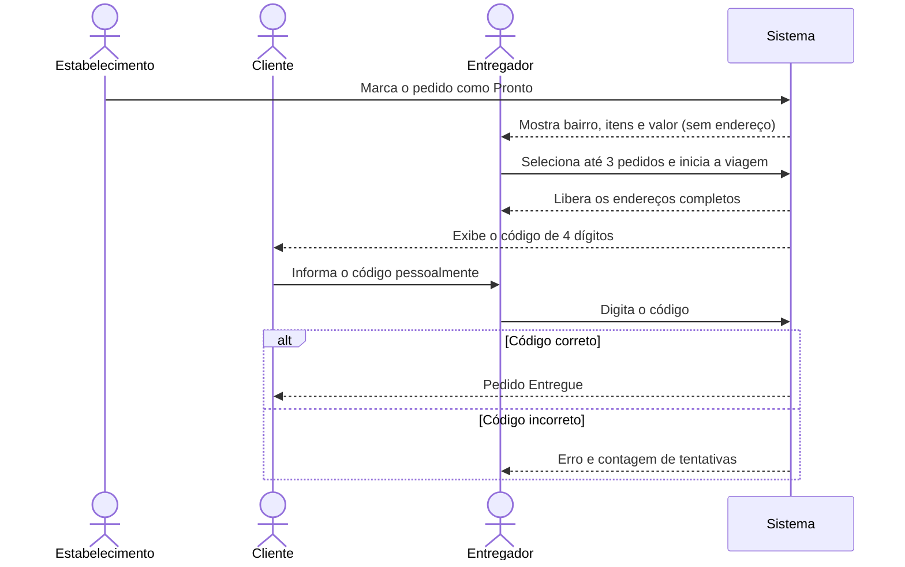
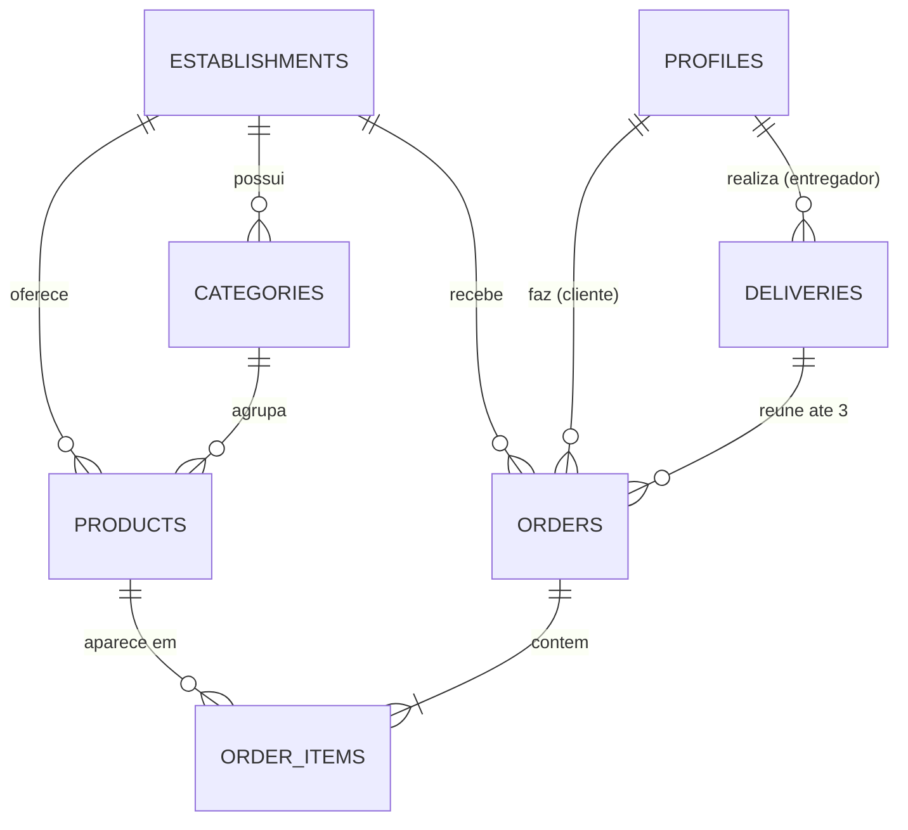

# Peddi - Pedidos, Cardápio e Entregas para Negócios de Alimentação

> Sistema Web para pizzarias, hamburguerias, sorveterias, restaurantes, marmitarias e outros
> negócios de alimentação gerenciarem cardápio, pedidos e entregas, com painéis para
> estabelecimento, cliente e entregador e confirmação de entrega por código.


-orange)



🔗 **Veja o sistema no ar:** [josehenrique26.github.io/peddi](https://josehenrique26.github.io/peddi/)

---

## Ideia, Objetivo Principal & Público-Alvo

- **Ideia & Objetivo:** Centralizar em um único sistema o cardápio digital, o recebimento
  de pedidos e o controle das entregas de pequenos negócios de alimentação, sem depender
  de comissões de grandes plataformas de delivery. O Peddi é configurável: cada
  estabelecimento define seu nome, tipo de negócio, categorias e produtos.
- **Público-Alvo:**
  - **Estabelecimento (empresa):** donos e atendentes de pizzarias, hamburguerias,
    sorveterias, restaurantes, marmitarias e deliveries de pequeno porte;
  - **Cliente:** pessoas que desejam pedir de forma rápida e acompanhar o andamento do pedido;
  - **Entregador:** profissionais que realizam as entregas do estabelecimento.
- **Problema:** Pedidos recebidos por WhatsApp e telefone geram erros de anotação, perda de
  pedidos, cardápios desatualizados, falta de controle sobre quem entregou o quê e
  dificuldade de confirmar que o pedido chegou ao cliente. As grandes plataformas resolvem
  parte disso, mas cobram taxas altas, o que pesa para quem tem margem pequena.
- **Solução & Valor:** Interface Web simples com três perfis. O estabelecimento gerencia o
  cardápio e o fluxo dos pedidos, o cliente faz o pedido e acompanha o status, e o
  entregador seleciona até 3 pedidos por viagem. A entrega só é concluída quando o
  entregador informa o **código de confirmação** exibido na tela do cliente.

### Como o Peddi se adapta a cada negócio

O fluxo de pedido e de entrega é o mesmo; o que muda é o cardápio, definido pelo estabelecimento.

| Negócio | Exemplos de categorias | Exemplos de produtos |
| ------- | ---------------------- | -------------------- |
| Pizzaria | Salgadas, Doces, Bebidas | Calabresa, Margherita, Brownie |
| Hamburgueria | Lanches, Porções, Bebidas | Cheeseburger, Batata frita |
| Sorveteria | Sorvetes, Açaí, Casquinhas | Açaí 500 ml, Casquinha dupla |
| Restaurante | Pratos, Sobremesas, Bebidas | Prato do dia, Mousse |
| Marmitaria | Marmitas, Acompanhamentos, Bebidas | Marmita média, Suco natural |

> Escopo do Projeto 1.1: **um estabelecimento por instalação**, configurável. O modelo de
> dados do Projeto 1.2 já nasce preparado (`establishments`) para evoluir a vários
> estabelecimentos.

### Perfis de usuário

| Perfil | O que pode fazer |
| ------ | ---------------- |
| 🏪 **Estabelecimento (empresa)** | Configurar o negócio, gerenciar o cardápio (CRUD), ver pedidos, avançar o status até "Pronto", consultar faturamento e histórico. |
| 🛒 **Cliente** | Ver o cardápio, filtrar por categoria, montar o carrinho, finalizar o pedido, acompanhar o status e consultar o código de entrega. |
| 🛵 **Entregador** | Ver apenas pedidos "Prontos", selecionar até 3 por viagem, iniciar a viagem, ver os endereços e confirmar a entrega com o código. |

### Ciclo de vida do pedido



> O cancelamento é possível **antes** de "Saiu para entrega".

### Regras do fluxo de entrega

1. Quando o estabelecimento marca o pedido como **Pronto**, ele aparece na lista do entregador
   mostrando apenas **bairro, itens e valor**. O endereço completo fica oculto.
2. O entregador **seleciona até 3 pedidos** para formar uma viagem. Um pedido só pode ser
   reservado por um entregador (reserva atômica, para que dois entregadores não peguem o mesmo).
3. Ao **iniciar a viagem**, os pedidos mudam para **Saiu para entrega**, o entregador passa a
   ver os **endereços completos** e o sistema **gera um código de 4 dígitos** por pedido.
4. O código aparece **somente na tela do cliente**.
5. No local, o cliente informa o código e o entregador o digita no sistema.
6. Código correto: o pedido muda para **Entregue**. Código incorreto: erro e **limite de tentativas**.
7. Uma nova viagem só começa quando todos os pedidos da atual estiverem **entregues ou cancelados**.

<details>
<summary>📈 Ver o diagrama da confirmação por código</summary>



</details>

---

## Benchmarking (Análise Comparativa)

| Ferramenta | Pontos Fortes | Limitações | Diferencial da Solução |
| ---------- | ------------- | ---------- | ---------------------- |
| iFood | Grande base de clientes e entrega integrada | Comissões altas para o estabelecimento | Sem comissão e com controle próprio dos clientes |
| Anota AI | Cardápio digital e pedidos via WhatsApp | Foco em atendimento, pouca gestão de entregas | Controle da viagem do entregador e confirmação por código |
| Goomer | Cardápio digital e gestão de pedidos | Planos pagos e funcionalidades amplas demais | Interface enxuta, adaptável a vários tipos de negócio |
| Cardápio Web | Painel completo para o lojista | Curva de aprendizado e custo mensal | Fluxo simples com três perfis bem definidos |

---

## Equipe

- **Eric Fabrício Dantas Linhares** - 202614320012 | [GitHub](https://github.com/ericfabricio7) | [LinkedIn](https://www.linkedin.com/in/eric-fabricio/)
- **Gabriel Leite Cavalcanti de Albuquerque** - 202614320027 | [GitHub](https://github.com/leitecavalcanti-lab) | [LinkedIn](https://www.linkedin.com/in/gabriel-cavalcanti-241a44432/)
- **José Henrique de Sousa Leite** - 202614320021 | [GitHub](https://github.com/josehenrique26) | [LinkedIn](https://www.linkedin.com/in/jos%C3%A9-henrique-de-sousa-leite-b861463b4)
- **Mateus Menezes de Souza** - 202614320031 | [GitHub](https://github.com/mateussmenezes) | [LinkedIn](https://www.linkedin.com/in/mateus-menezes-705782406/)

---

## Documentação & Recursos

- **Pitch / Apresentação:** [PREENCHER: link dos slides da proposta]
- **Protótipos / Design:** [Ver protótipos](docs/prototypes/) | [Figma](https://www.figma.com/make/O4jmNIXp7j0otHUTHx6u82/PizzaFlow-Web-App-Design)
- **Workflow / Kanban:** [GitHub Projects](https://github.com/users/josehenrique26/projects/2)
- **Documentação do Projeto:** [Ver pasta de documentação](docs/)
  - [Modelo de dados](docs/data-model.md)
  - [Regras da viagem e do código de entrega](docs/delivery-flow.md)

---

## Páginas / Telas da Aplicação (GitHub Pages)

**Índice**

- 🏠 **Índice / Home:** [https://josehenrique26.github.io/peddi/](https://josehenrique26.github.io/peddi/)

**Acesso**

- 🔑 **Login:** [login.html](https://josehenrique26.github.io/peddi/screens/auth/login.html)
- 📝 **Cadastro:** [register.html](https://josehenrique26.github.io/peddi/screens/auth/register.html)

**Cliente**

- 🍽️ **Cardápio:** [menu.html](https://josehenrique26.github.io/peddi/screens/client/menu.html)
- 🛒 **Carrinho e Checkout:** [cart.html](https://josehenrique26.github.io/peddi/screens/client/cart.html)
- 📦 **Meus Pedidos:** [orders.html](https://josehenrique26.github.io/peddi/screens/client/orders.html)
- 🔢 **Acompanhamento (com código de entrega):** [order-tracking.html](https://josehenrique26.github.io/peddi/screens/client/order-tracking.html)

**Estabelecimento**

- 📊 **Dashboard:** [dashboard.html](https://josehenrique26.github.io/peddi/screens/company/dashboard.html)
- 📋 **Gestão de Cardápio:** [admin-menu.html](https://josehenrique26.github.io/peddi/screens/company/admin-menu.html)
- 🧾 **Gestão de Pedidos:** [admin-orders.html](https://josehenrique26.github.io/peddi/screens/company/admin-orders.html)

**Entregador**

- 🛵 **Pedidos Disponíveis:** [available.html](https://josehenrique26.github.io/peddi/screens/courier/available.html)
- 🗺️ **Viagem Atual e Confirmação por Código:** [trip.html](https://josehenrique26.github.io/peddi/screens/courier/trip.html)

> Nesta etapa as telas são **estáticas, com dados fictícios** (HTML + CSS). Nada é gravado e não há login real.

---

## Funcionalidades Planejadas (Features)

O backlog completo (requisitos funcionais e não funcionais, com critérios de aceitação) está no [GitHub Projects](https://github.com/users/josehenrique26/projects/2).

### Etapa inicial (interface estática com dados fictícios)

- [x] Telas estáticas dos três perfis (HTML + CSS)
- [x] Página `index.html` com links para todas as telas
- [x] Telas responsivas (celular e computador)
- [x] Badges de status padronizados em todas as telas
- [ ] Identidade visual do Peddi (nome, logo e paleta) aplicada a todas as telas
- [ ] Vocabulário neutro nas telas (produto, categoria e estabelecimento)

### Projeto 1.1 (Front-end Vanilla)

- [ ] Perfil simulado por seletor (sem login real)
- [ ] Configuração do estabelecimento: nome, tipo de negócio, logo, horário e taxa de entrega
- [ ] Listagem do cardápio com filtro por categoria e busca (`filter`)
- [ ] Carrinho com observação por item e total calculado (`map` e `reduce`)
- [ ] Checkout com endereço (CEP via ViaCEP) e forma de pagamento
- [ ] CRUD de produtos e categorias pelo estabelecimento (LocalStorage ou `json-server`)
- [ ] Criação de pedidos, acompanhamento e alteração de status ao longo do fluxo
- [ ] Seleção de até 3 pedidos por viagem, com reserva sem duplicidade
- [ ] Código de entrega de 4 dígitos, confirmação, limite de tentativas e registro de falha na entrega
- [ ] Painel do estabelecimento com faturamento, ticket médio e ranking (`reduce`)
- [ ] Organização modular com ESM e uso do Vite (template vanilla)

### Projeto 1.2 (Next.js, React e Supabase)

- [ ] Autenticação (cadastro, login e logout) com Supabase Auth
- [ ] Proteção de rotas por perfil (cliente, estabelecimento e entregador)
- [ ] Persistência no PostgreSQL (Supabase), com modelo preparado para vários estabelecimentos
- [ ] Políticas de Row Level Security por perfil
- [ ] Funções no banco: reservar pedidos, iniciar viagem e confirmar entrega
- [ ] Formulários validados com React Hook Form e Zod (cadastro, endereço, CEP, telefone e produto)
- [ ] Estado com Zustand (carrinho) e TanStack Query (dados do servidor)
- [ ] Atualização de status dos pedidos (polling ou Supabase Realtime)
- [ ] Upload de imagens dos produtos e da logo (Supabase Storage)

### Fora do escopo inicial (possíveis evoluções)

- Vitrine com vários estabelecimentos para o cliente escolher
- Pagamento online real (será simulado: dinheiro, pix fictício e cartão na entrega)
- Rastreamento do entregador em mapa
- Adicionais e combos personalizados
- Notificações push ou por WhatsApp

---

## Estratégia para Obtenção de Dados Reais (Hipóteses Técnicas)

- **Fontes de Dados & Coleta:**
  - Cardápio e categorias cadastrados pelo próprio estabelecimento, com opção futura de
    importação em lote via arquivo CSV;
  - Preenchimento automático de rua, bairro e cidade pelo CEP com a API [ViaCEP](https://viacep.com.br/);
  - Imagens dos produtos e logo enviadas pelo estabelecimento e armazenadas no **Supabase Storage**.
- **Armazenamento & API:**
  - Tabelas modeladas no **Supabase PostgreSQL** (modelo abaixo);
  - Autenticação com **Supabase Auth**, com o papel do usuário guardado em `profiles`;
  - **Row Level Security (RLS)**: o cliente vê apenas seus pedidos, o entregador vê apenas
    pedidos "Prontos" (sem endereço completo) e os da própria viagem, e o estabelecimento vê todos os seus;
  - Reserva dos pedidos e validação do código por **funções SQL (RPC)** do Supabase, garantindo
    atomicidade, limite de 3 pedidos por viagem e limite de tentativas;
  - Atualização de status por polling com TanStack Query, com **Supabase Realtime** como evolução.

### Do dado fictício ao dado real

| O que a tela mostra hoje (fictício) | De onde virá o dado real | Quando |
| ----------------------------------- | ------------------------ | ------ |
| Nome, tipo e taxa do estabelecimento | Configuração feita pelo estabelecimento | 1.1: LocalStorage; 1.2: tabela `establishments` |
| Produtos, categorias e preços | Cadastro feito pelo estabelecimento (CRUD) | 1.1: LocalStorage ou `json-server`; 1.2: `products` e `categories` |
| Fotos e logo | Upload feito pelo estabelecimento | 1.2: Supabase Storage |
| Endereço do cliente | Digitação + consulta de CEP no ViaCEP | 1.1 e 1.2 |
| Pedidos e status | Criação pelo cliente e avanço pelo estabelecimento | 1.1: LocalStorage; 1.2: `orders` e `order_items` |
| Viagem e código de entrega | Geração ao iniciar a viagem | 1.1: função em `utils/`; 1.2: função RPC no banco |
| Faturamento do dashboard | Soma dos pedidos não cancelados (`reduce`) | 1.1 e 1.2 |
| Login e perfil | Cadastro real de usuários | 1.2: Supabase Auth + `profiles` |

### Modelo de dados inicial

| Tabela | Principais campos |
| ------ | ----------------- |
| `establishments` | id, nome, tipo_negocio, logo_url, horario, taxa_entrega |
| `profiles` | id, nome, telefone, papel (`cliente`, `empresa`, `entregador`) |
| `categories` | id, establishment_id, nome |
| `products` | id, establishment_id, nome, descricao, preco, imagem_url, category_id, disponivel |
| `orders` | id, establishment_id, cliente_id, delivery_id, status, total, endereco, bairro, forma_pagamento, codigo_entrega, tentativas, criado_em |
| `order_items` | id, order_id, product_id, quantidade, preco_unitario, observacao |
| `deliveries` | id, entregador_id, status (`em_andamento`, `finalizada`), iniciada_em, finalizada_em |

<details>
<summary>🗺️ Ver o diagrama de relacionamento das tabelas</summary>



</details>

---

## Tecnologias

- **Etapa inicial:** HTML5, CSS3 e Tailwind CSS
- **Projeto 1.1:** JavaScript (ESM), Vite (template vanilla), LocalStorage ou `json-server`
- **Projeto 1.2:** Next.js (App Router), TypeScript, React, Tailwind CSS, shadcn/ui, Supabase, React Hook Form, Zod, Zustand, TanStack Query
- **Qualidade (diferenciais):** Vitest, Testing Library, Playwright, Biome, Husky e lint-staged

### Como cada critério da disciplina será atendido

<details>
<summary>📌 Projeto 1.1 (Vanilla)</summary>

| Critério | Onde aparece no Peddi |
| -------- | --------------------- |
| Programação funcional | `filter` no cardápio por categoria e busca; `map` para montar as listas; `reduce` no total do carrinho, no faturamento e no ranking |
| ESM | Todo o `src/` com `import` e `export`, separado em `pages/`, `components/`, `services/` e `utils/` |
| Estruturação de dados | Produtos, categorias, pedidos e viagens em arrays, persistidos no LocalStorage ou `json-server` |
| DOM e componentes dinâmicos | Cards, badges e modais criados com `createElement` e `appendChild`, mais o CRUD do cardápio |
| Eventos | Cliques (adicionar ao carrinho, mudar status), formulários e campos de busca e filtro |
| Vite | Projeto criado a partir do template vanilla, em `vanilla/` |

</details>

<details>
<summary>📌 Projeto 1.2 (React + Supabase)</summary>

| Critério | Onde aparece no Peddi |
| -------- | --------------------- |
| Arquitetura | Next.js (App Router) e TypeScript, com `app/`, `components/`, `hooks/`, `services/`, `schemas/` e `stores/` |
| Supabase | Login, cadastro, logout, proteção de rotas por perfil e CRUD no PostgreSQL |
| Componentes e UI | Componentes reutilizáveis com Tailwind CSS e shadcn/ui, layout responsivo |
| Formulários | React Hook Form + Zod + RegExp (CEP e telefone), com mensagens de erro |
| Estado | `useState`, Zustand (carrinho e sessão) e TanStack Query (dados do servidor) |

</details>

---

## Estrutura do Repositório

Um único repositório com uma pasta por etapa. Cada pasta é independente.

<details>
<summary>📁 Ver a estrutura de pastas</summary>

```text
peddi/
├── index.html          índice de links das telas estáticas
├── README.md
├── preview.png         print 16:9, até 500 KB
├── .github/            modelos de issue e de pull request
├── docs/
│   ├── prototypes/     prints do Figma e logo
│   ├── data-model.md   tabelas do Supabase
│   └── delivery-flow.md regras da viagem e do código
├── screens/            ETAPA INICIAL (HTML + CSS)
│   ├── assets/         css e imagens
│   ├── auth/           login, register
│   ├── client/         menu, cart, orders, order-tracking
│   ├── company/        dashboard, admin-menu, admin-orders
│   └── courier/        available, trip
├── vanilla/            PROJETO 1.1 (Vite + JavaScript puro)
└── web/                PROJETO 1.2 (Next.js + Supabase)
```

</details>

---

## Como executar

> Esta seção será atualizada a cada etapa, com instruções de instalação, configuração (`.env.example`) e execução.

```bash
git clone https://github.com/josehenrique26/peddi.git
cd peddi
```

**Etapa inicial (telas estáticas):** abra o `index.html` no navegador ou acesse a versão publicada no [GitHub Pages](https://josehenrique26.github.io/peddi/).

**Projeto 1.1 (`vanilla/`):** instruções de instalação e execução serão adicionadas ao concluir a etapa.

**Projeto 1.2 (`web/`):** instruções de instalação, variáveis de ambiente (`.env.example`) e execução serão adicionadas ao concluir a etapa.

---

## Fluxo de Trabalho

- Uma **issue por requisito**, com objetivo e critérios de aceitação em checklist (RF-GEN, RF-CLI, RF-EMP, RF-ENT e RNF).
- Labels por **perfil** (`cliente`, `empresa`, `entregador`, `geral`), por **tipo** (`rnf`) e por **etapa** (`inicial`, `1.1`, `1.2`).
- Quadro Kanban no GitHub Projects: Backlog, Em andamento, Em revisão e Concluído.
- Todo commit ou pull request cita a issue (`closes #N`), registrando a participação de cada integrante.

---

## Licença

Distribuído sob a licença MIT. Veja o arquivo [LICENSE](LICENSE).
